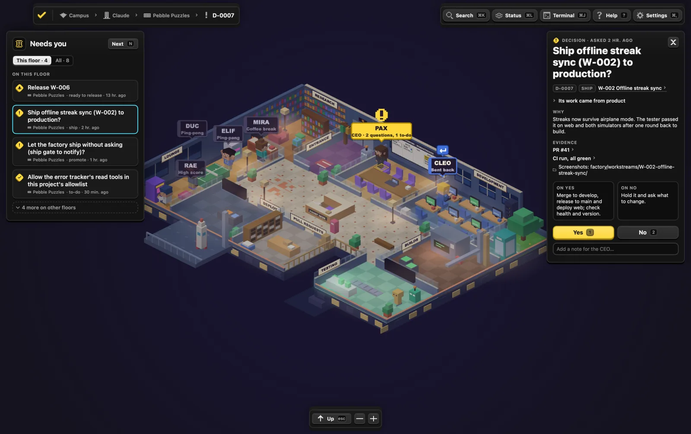
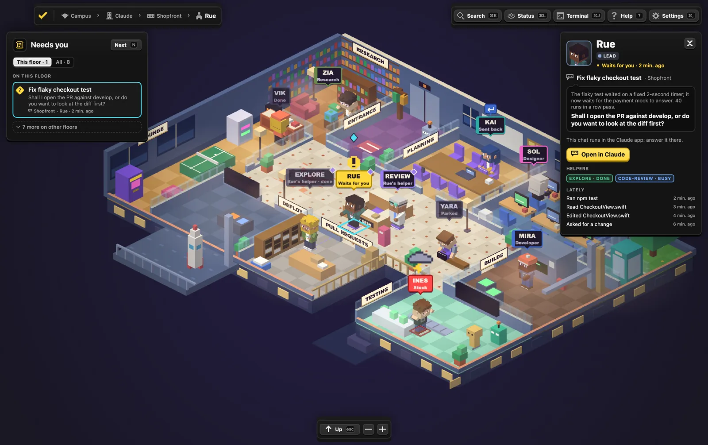
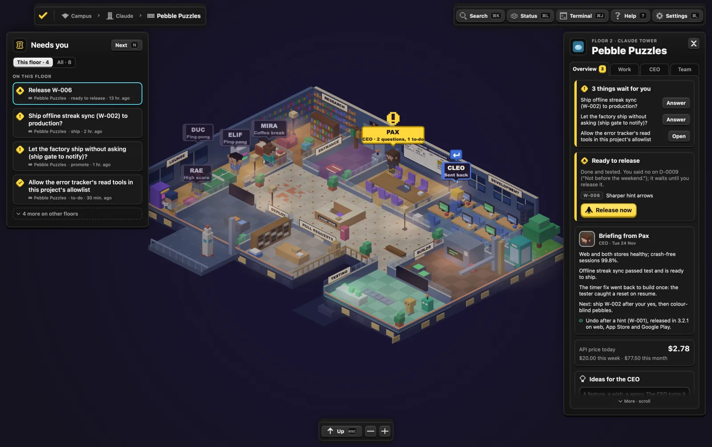
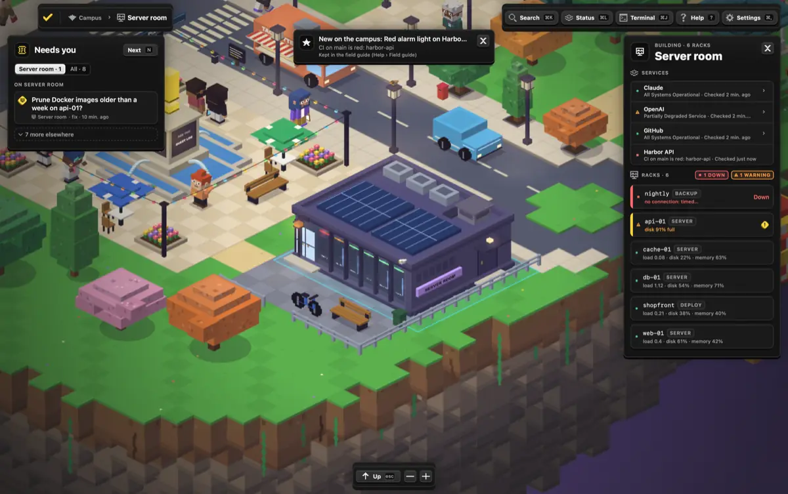
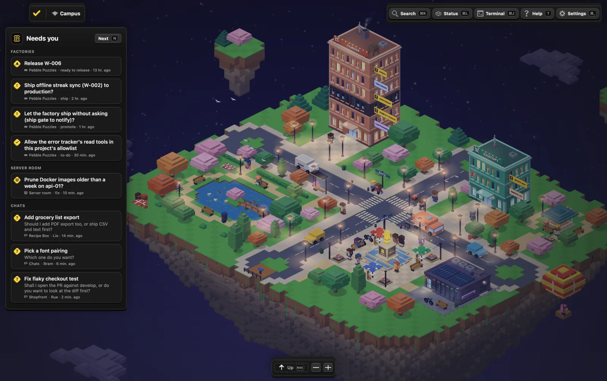

<p align="center">
  
</p>

<h1 align="center">Meatproxy</h1>

<p align="center"><b>Approved by a human. Reviewed by nobody.</b><br>
<a href="https://marcel.tuinstra.dev/en/blog/my-agents-got-a-campus/">Watch the 34-second trailer</a> · <a href="SETUP.md">Set it up</a></p>

Your AI agents moved out of the terminal. Meatproxy is a Mac app that turns the Claude Code and Codex sessions on your
Mac into a small blocky campus: **one tower per provider, one floor per project, one person per chat.** You see at a
glance who works, who is stuck and who waits for you, and you answer them without hunting through terminals.

## Everything that waits for you, in one list



Questions from your factories, to-dos only you can do, finished work that waits for your release, and chats that end
on a question. Answer with **Yes** or **No**, mark a to-do **Done**, or press **Release now**, right where it asks.

## A floor per project



Every chat is a person who walks to the room of what it is doing: reading in Research, typing in Development, a red
cloud when a test fails, a raised hand when it waits for you. Click someone to read what they asked, then take over in
the terminal or open the chat in the Claude app.

## Dark Software Factories



Switch a project on as a **factory** and an AI CEO works on it on a heartbeat, within a mandate you set: how many
runs a day, what it may do on its own, and which helpers it may call in. It plans the work, hands it to its team and
asks you only when it needs a yes. Everything it knows lives as plain files in the project.

## The Server room



Your servers and sites, checked over SSH with your own keys, with alerts when something goes down. A DevOps agent can
look into them through a small ops tool, as far as each server allows, and writes a journal of what it found.

<p align="center"><br>
<sub>By night only real lights glow. All images use made-up data.</sub></p>

## Get it

macOS 15 or newer and Xcode 26. There is no download: you build it yourself.

```bash
git clone https://github.com/marcel-tuinstra/meatproxy.git
cd meatproxy
scripts/make-app.sh
```

That builds Meatproxy, puts it in `/Applications` and you are on the campus. **Take the walk** shows you round in a
minute. Factories, servers and everything else: [SETUP.md](SETUP.md).

**Local only.** Meatproxy reads your session files read-only. There is no server, no account and no analytics.
Settings › Privacy lists everything it reads and contacts.

---

A personal hobby project, made by a human with a lot of agents. MIT licensed, see [LICENSE](LICENSE). Working on the
code: [docs/development.md](docs/development.md).

> Still needed. Legally.
